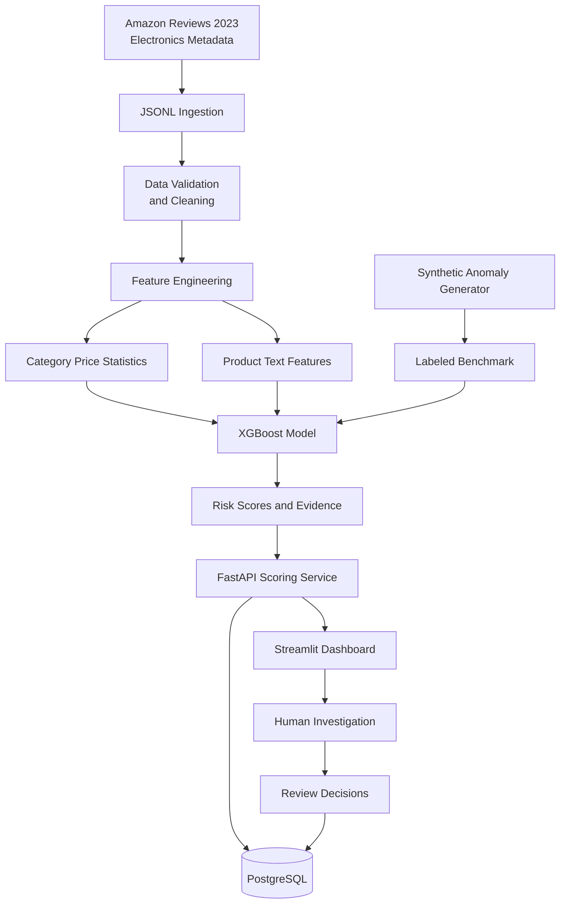

# E-Commerce Pricing Risk Detection System

An end-to-end machine learning application that identifies potentially unusual e-commerce prices and prioritizes product listings for human investigation.

Built with **Python, XGBoost, Sentence Transformers, PostgreSQL, FastAPI, Streamlit, and Docker**, the system combines pricing analytics, product metadata, and text features to generate explainable pricing-risk scores.

> **Important:** A high risk score is a prioritization signal, not proof of fraud. Every flagged listing requires human review.

## Key Features

- **Pricing anomaly detection:** Identify unusually high or low prices relative to category benchmarks.
- **Feature engineering:** Combine price deviations, discount signals, product attributes, and semantic text representations.
- **Machine learning:** Train an XGBoost classifier using a reproducible synthetic-anomaly benchmark.
- **Explainable scoring:** Display risk scores and supporting evidence to help reviewers investigate flagged listings.
- **REST API:** Serve predictions and manage products through FastAPI.
- **Persistent storage:** Store product metadata, scoring history, and reviewer decisions in PostgreSQL.
- **Interactive dashboard:** Explore pricing risks and investigate suspicious listings with Streamlit.
- **Reproducible evaluation:** Measure precision, recall, F1, PR-AUC, and the percentage of listings flagged for review.
- **Containerized deployment:** Run the API, dashboard, and database with Docker Compose.

## Technology Stack

| Component | Technology |
|---|---|
| Language | Python 3.11+ |
| Machine learning | XGBoost, scikit-learn |
| Text features | Sentence Transformers or deterministic hashed text features |
| Data processing | pandas, NumPy |
| Database | PostgreSQL, SQLAlchemy |
| Database migrations | Alembic |
| Backend | FastAPI, Pydantic |
| Dashboard | Streamlit, Plotly |
| Testing | pytest |
| Deployment | Docker, Docker Compose |

## Architecture



## Dataset

The intended real-world data source is [Amazon Reviews 2023](https://amazon-reviews-2023.github.io/), specifically the Electronics product metadata.

This repository does not automatically download the full dataset.

The included `data/sample/products.jsonl` file contains **synthetic development data**, not real Amazon product records.

The ingestion pipeline supports fields such as:

- ASIN or product ID
- Product title and category
- Observed price and list price
- Discount information
- Brand and product description
- Product features
- Rating and rating count

Missing fields remain missing unless a value can be derived from available information using a documented calculation.

### Data limitations

Amazon metadata does not provide verified labels for suspicious pricing. Price coverage, category consistency, list-price semantics, and product-variant information may also be incomplete.

Consequently, the project uses synthetic anomaly labels to evaluate controlled experiments. Results from this benchmark should not be interpreted as verified real-world fraud-detection performance.

## Machine Learning Methodology

### 1. Feature engineering

The pipeline builds structured and textual features, including:

- Log-transformed product price
- Category-relative price deviation
- Category median and robust MAD-based price statistics
- Relative price ratios and category price ranks
- Discount-related features when list-price information is available
- Product attributes and missing-data indicators
- Product title, description, and feature text representations

Category statistics are fitted using the training partition only. Unseen or small categories use a training-derived global fallback to reduce data leakage and improve robustness.

### 2. Text representation

The application supports two approaches:

**Offline mode:** Deterministic hashed text features provide a lightweight default for local development.

**Transformer mode:** Sentence Transformer embeddings can be enabled using `sentence-transformers/all-MiniLM-L6-v2`.

Transformer mode may require downloading model weights or configuring a local model cache. Model configuration must remain consistent between training and inference.

### 3. Synthetic anomaly benchmark

Because verified pricing-risk labels are unavailable, the benchmark injects controlled anomalies into product records.

Examples include:

- Prices substantially above category benchmarks
- Unusually low prices
- Inconsistent price and list-price relationships

Product identities are split before anomaly injection to reduce leakage between training, validation, and test sets. The model is trained on labeled synthetic examples, and its operating threshold is selected using validation data.

The final evaluation is performed on a held-out test set.

### 4. Model evaluation

The evaluation pipeline reports:

- Precision
- Recall
- F1 score
- Precision-recall AUC
- Confusion matrix
- Percentage of listings flagged for review
- Selected decision threshold
- Comparison with a category-relative rule-based baseline

The project aims to balance anomaly detection against investigation workload. The actual operating point depends on the data and the benchmark design.

**No performance metrics are claimed until a training run successfully generates and verifies them.** Synthetic benchmark results measure recovery of injected patterns, not confirmed real-world pricing errors.

## Application Components

### FastAPI backend

The REST API provides product retrieval, scoring, risk summaries, evaluation metrics, and review management.

| Endpoint | Purpose |
|---|---|
| `GET /health` | Check API and database readiness |
| `GET /products` | Retrieve and filter product listings |
| `GET /products/{product_id}` | Retrieve product details and score history |
| `POST /score` | Score and persist a single product |
| `POST /score/batch` | Score a batch of up to 100 products |
| `GET /risk/summary` | Retrieve aggregate risk statistics |
| `GET /metrics` | Retrieve available benchmark metrics |
| `POST /reviews/{score_id}` | Record a human review decision |
| `GET /reviews` | Retrieve review history |

Interactive API documentation is available at `/docs`.

Example scoring request:

```bash
curl -X POST http://localhost:8000/score \
  -H "Content-Type: application/json" \
  -d "{\"product\":{\"product_id\":\"demo-1\",\"title\":\"Example headphones\",\"category\":\"Headphones\",\"price\":249.99,\"brand\":\"Example\",\"description\":\"Over-ear wireless headphones\"}}"
```

### PostgreSQL database

SQLAlchemy models and Alembic migrations manage:

- Product metadata
- Product scoring history
- Risk and review flags
- Human review decisions and timestamps

Review decisions include:

- `Confirmed Anomaly`
- `Expected Pricing`
- `Needs More Information`

Reviewer decisions are stored separately from model predictions so that the model's output does not automatically determine the final outcome.

### Streamlit dashboard

The dashboard provides an interface for:

- Reviewing aggregate risk statistics
- Filtering and sorting flagged products
- Comparing product prices with category benchmarks
- Inspecting risk scores and supporting evidence
- Reviewing historical scores
- Recording human investigation outcomes
- Exploring available model evaluation metrics

The dashboard communicates with the FastAPI backend rather than maintaining a separate prediction pipeline.

## Getting Started

### Prerequisites

For local development, install:

- Python 3.11 or 3.12
- Git
- PostgreSQL, or Docker Desktop for the database and containerized deployment

### Option 1: Run locally on Windows

Clone the repository:

```powershell
git clone https://github.com/YOUR-USERNAME/ecommerce-pricing-risk-detection.git
cd ecommerce-pricing-risk-detection
```

Create and activate a virtual environment:

```powershell
python -m venv .venv
.\.venv\Scripts\Activate.ps1
```

Install the project and test dependencies:

```powershell
python -m pip install --upgrade pip
python -m pip install -e ".[test]"
```

If your PowerShell execution policy prevents environment activation, you can invoke the environment's Python directly using `.venv\Scripts\python.exe`.

Configure environment variables:

```powershell
Copy-Item .env.example .env
```

Review `.env` and configure your PostgreSQL connection details. Do not commit this file.

Start PostgreSQL and ensure the configured database exists. If you have Docker Desktop installed, you can start the database service with:

```powershell
docker compose up -d db
```

Initialize the demo:

```powershell
python scripts/init_demo.py
```

Start the API in one terminal:

```powershell
uvicorn app.api.main:app --reload
```

Start the dashboard in a second terminal:

```powershell
streamlit run dashboard/app.py
```

Open the application:

- Dashboard: http://localhost:8501
- API: http://localhost:8000
- API documentation: http://localhost:8000/docs

The initialization workflow is designed to apply database migrations, prepare demo data, train the demo model, and generate scoring results. Model training should be considered successful only if the script completes and the expected artifacts are created.

### Option 2: Run with Docker Compose

Make sure Docker Desktop is installed and running.

Build and start the services:

```bash
docker compose up --build -d
```

Initialize the demo:

```bash
docker compose exec api python scripts/init_demo.py
```

Open:

- Dashboard: http://localhost:8501
- API: http://localhost:8000
- API documentation: http://localhost:8000/docs

Check service status:

```bash
docker compose ps
docker compose logs api
docker compose logs dashboard
```

The bundled Compose credentials are intended for local development only. Configure appropriate credentials, secrets, and access controls before any deployment beyond your own machine.

## Training on Real Electronics Metadata

Download an official documented Electronics metadata file separately and store it locally. Do not commit the full dataset to GitHub.

In your configured Python environment, ingest the data:

```bash
python scripts/ingest.py /path/to/electronics.jsonl
```

Train the model and generate evaluation metrics:

```bash
python scripts/train_model.py --input /path/to/electronics.jsonl
```

The expected metrics artifact is:

```text
models/metrics.json
```

The precise artifact paths and required environment configuration should match the implementation in the repository.

For transformer embeddings, configure the appropriate embedding mode and model before training. Ensure the same feature configuration is used for serving predictions.

## Running Tests

Run the automated tests:

```bash
python -m pytest -q
```

The test suite is intended to cover:

- JSONL ingestion and malformed records
- Missing values and feature calculations
- Reproducible synthetic anomaly injection
- Train/test product identity separation
- Training-only category statistics
- Model serialization and inference
- Database persistence and scoring history
- Database migrations
- API validation and review workflows
- Dashboard empty states and API failure handling

Tests should be considered passing only after they execute successfully in the configured environment.

## Responsible Use

This system identifies listings that may warrant closer inspection. It does not establish seller intent, fraud, or policy violations.

A flagged price may be legitimate because of:

- Product variants or bundles
- Geographic pricing differences
- Taxes, shipping, or promotions
- Inventory changes and timing
- Incomplete or inaccurate metadata

Human reviewers should evaluate the evidence before taking action. Review outcomes should be retained separately from predictions, and model performance should be monitored across categories and product attributes.

## Limitations and Future Improvements

Potential next steps include:

- Evaluating against independently verified pricing-error labels
- Building variant-aware price comparisons
- Improving category normalization
- Calibrating predicted probabilities
- Monitoring data and model drift
- Adding authentication and reviewer access controls
- Implementing rate limiting and structured observability
- Establishing retention policies for stored product and review data
- Comparing transformer embeddings against simpler text baselines

## Screenshots

Add screenshots of the dashboard to a documentation assets directory once the application has been launched successfully.

Recommended screenshots:

1. Overview — aggregate risk statistics and distribution
2. Risk Explorer — searchable product risk table
3. Investigation Details — category comparison and supporting evidence
4. Model Performance — actual benchmark metrics and baseline comparison

## Project Status

This repository is intended as a reproducible portfolio demonstration of an end-to-end ML application.

The architecture, synthetic-data workflow, scoring API, database integration, and dashboard are designed to work together. Actual model performance and deployment readiness must be established by running the training pipeline, automated tests, and application services in a properly configured environment.

**Built to demonstrate:** Machine learning, feature engineering, data pipelines, backend APIs, relational databases, model evaluation, and human-in-the-loop decision support.

