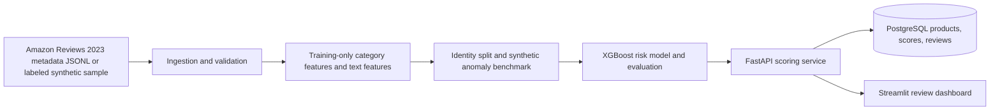

# E-Commerce Pricing Risk Detection System

A portfolio demo that ranks product listings for human review when observed pricing looks unusual relative to a product category. The score is a prioritization signal, never a finding of fraud.

## Architecture



## Data and limitations

The intended real source is the Electronics metadata from [Amazon Reviews 2023](https://amazon-reviews-2023.github.io/). This repository does not download it. Fetch an official documented metadata file yourself and pass its local JSONL path to `scripts/ingest.py` / `scripts/train_model.py`. The metadata does not provide verified suspicious-pricing labels, and price coverage/semantics may be incomplete. The included `data/sample/products.jsonl` is entirely synthetic development data, not real product information. The ingestion adapter accepts ASIN, title, category, price, list price, discount, brand, description, features, rating, and rating count; absent fields stay missing. Discount is derived only when list price and observed price support the arithmetic.

## Feature and benchmark methodology

Category median, robust MAD-based scale, and category price ranks are fit using the training partition only. Unseen/small categories fall back to the training global median. Missing-price and missing-attribute indicators, log price, discount, rating fields, and deterministic hashed title/description/features vectors are combined. Hashed vectors are the offline lightweight default. The compatible `sentence-transformers` package is included but model weights are not fetched on startup. To opt into transformer features, set `EMBEDDING_MODE=transformer` and `EMBEDDING_MODEL=sentence-transformers/all-MiniLM-L6-v2` while training and serving; the first model use requires network access or a pre-populated local model cache. Artifacts record this configuration. If those embeddings cannot load during inference, scoring falls back to a category rule and labels each response `rule_baseline_embedding_unavailable`.

Product identities are split before anomalies are injected. In each split, deterministic seeded injections create elevated prices, unusually low prices, and discount/list-price conflicts while retaining `original_price` and `injection_type`. These labels only measure recovery of the injected patterns. They are not representative labels or estimates of real-world fraud detection performance.

Training fits XGBoost, balances positive class weight, chooses the operating threshold on validation precision, and computes final metrics on a held-out test partition. It compares a category-relative rule with the model. The target 80% recall at 75% precision and roughly 15% review volume is an aspiration, not guaranteed.

## Quick start

Use Python 3.11 or 3.12. The manifest constrains compatible runtime families (FastAPI/Pydantic 2, SQLAlchemy 2, scikit-learn 1.5, XGBoost 2.1, and supporting packages). For a local environment:

```powershell
python -m venv .venv
.\.venv\Scripts\Activate.ps1
python -m pip install --upgrade pip
python -m pip install -e ".[test]"
Copy-Item .env.example .env
docker compose up -d db
python scripts/init_demo.py
uvicorn app.api.main:app --reload
```

In a second terminal, `streamlit run dashboard/app.py`. Visit `http://localhost:8501`, API `http://localhost:8000`, and docs `http://localhost:8000/docs`.

Docker:

```sh
docker compose up --build
```

Then run one-time demo setup in another terminal: `docker compose exec api python scripts/init_demo.py`. Dashboard is `http://localhost:8501`; API is `http://localhost:8000`. Model training is not done during container startup. Compose's demo database credentials are for local development only; set `POSTGRES_USER`, `POSTGRES_PASSWORD`, and `POSTGRES_DB` in `.env` before deployment. `DATABASE_URL_DOCKER` is used inside the API container; `DATABASE_URL` is the host-side connection.

To ingest local Amazon metadata, configure `DATABASE_URL`, then run `python scripts/ingest.py /path/to/electronics.jsonl`; to train: `python scripts/train_model.py --input /path/to/electronics.jsonl`. No credentials or dataset are committed.

## API

| Endpoint | Use |
|---|---|
| `GET /health` | API/database readiness |
| `GET /products?limit=50&category=Headphones` | Product listing/filtering |
| `GET /products/{product_id}` | Product, latest score, score history |
| `POST /score` | Score and persist one product |
| `POST /score/batch` | Score up to 100 products |
| `GET /risk/summary` | Risk counts and review volume |
| `GET /metrics` | Last held-out benchmark metrics |
| `POST /reviews/{score_id}` | Record human review outcome |
| `GET /reviews` | Review history |

Example:

```json
{"product":{"product_id":"demo-1","title":"Example headphones","category":"Headphones","price":249.99,"brand":"Example","description":"Over-ear wireless headphones","features":["wireless","over-ear"]}}
```

Example request: `curl -X POST http://localhost:8000/score -H "Content-Type: application/json" -d '{"product":{"product_id":"demo-1","title":"Example headphones","category":"Headphones","price":249.99,"brand":"Example","description":"Over-ear wireless headphones"}}'`. Batch requests accept 1–100 products. Invalid prices/ratings, empty IDs, malformed bodies, and batches over the limit receive 422. Each score is appended to product scoring history.

Review decisions are `Confirmed Anomaly`, `Expected Pricing`, and `Needs More Information`; review status is stored separately from prediction.

## Model performance

Run `python scripts/train_model.py` to produce measurements in `models/metrics.json`; the API serves these at `/metrics`. A real execution here has not produced metrics: the available runtime is missing scikit-learn, XGBoost, and joblib, and outbound package installation is blocked. No metrics are claimed. A successful run records precision, recall, F1, PR-AUC, confusion matrix, flagged fraction, threshold, and rule-baseline metrics. All labels and measurements come from synthetic anomaly injections only.

## Dashboard screenshots

Start the demo, open the Overview, Risk Explorer, and Model Performance tabs, then capture screenshots with your operating system's screenshot tool. Place portfolio screenshots in a separate documentation asset folder and link them here.

## Database and migrations

SQLAlchemy models cover products, scoring history (including the threshold-based review flag), and review history with timestamps, foreign keys, indexes, and unique product identity. `alembic/versions/0001_initial.py` creates the initial schema and `0002_store_flag_decision.py` stores the actual threshold decision. `scripts/init_demo.py` applies all migrations before inserting sample data; for an empty database without the demo, run `alembic upgrade head`. The API health endpoint remains unhealthy until the schema exists. Repeated ingestion merges by product ID; scoring appends history.

## Tests

Run `python -m pytest -q`. Tests cover malformed and duplicate ingestion, missing feature handling, reproducible/auditable anomaly injections, disjoint product identity splits, training-only category statistics, model serialization/inference, database merge and history persistence, Alembic migration on clean SQLite, API validation/pagination/reviews, and dashboard empty/outage handling. Tests use SQLite; Compose uses PostgreSQL.

## Responsible Use

Risk scores identify listings that may deserve closer inspection. They do not establish seller intent, fraud, or policy violations. Human reviewers should consider product variants, bundles, geography, taxes, inventory, timing, and data quality before taking action. Preserve reviewer decisions separately and monitor for category and attribute biases.

## Design decisions and future work

The default is a small offline demo: deterministic hashed text features and a category-relative rule fallback until the explicit training command is run. `python scripts/init_demo.py` generates labeled synthetic data, applies the migration, trains XGBoost, saves the model/metrics, and scores the sample. `python scripts/generate_sample.py` regenerates only the sample file. `python scripts/ingest.py PATH` validates and upserts JSONL; `python scripts/train_model.py --input PATH` trains from that file. Production deployment should add auth/rate limiting, observability, retention controls, richer variant-aware comparables, calibration, drift monitoring, reviewer access control, and validated transformer embeddings. Amazon metadata may not contain reliable current prices, list prices, or normalized categories.
